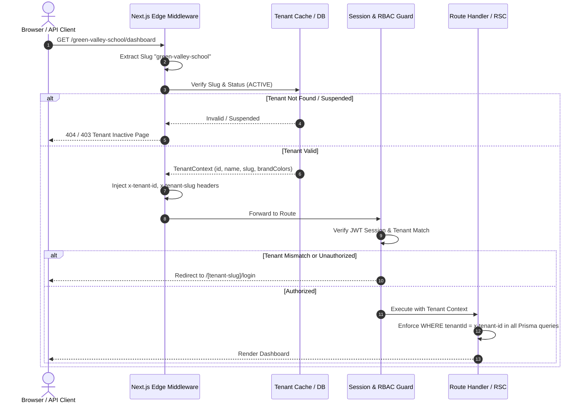
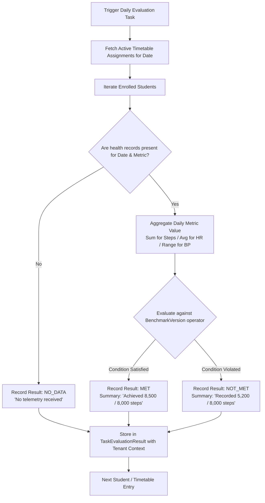
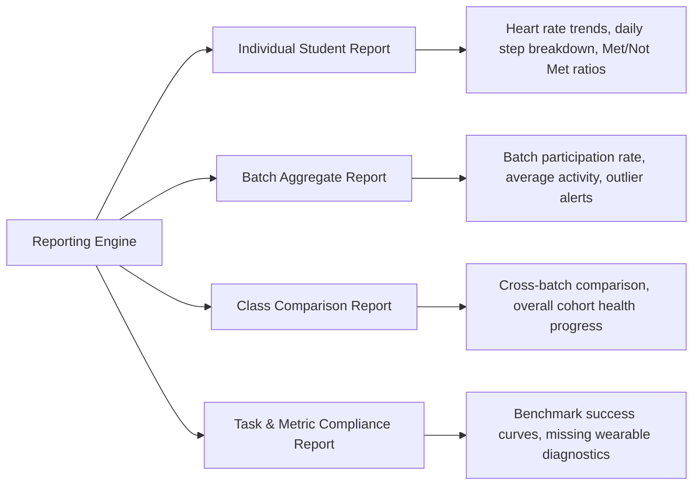
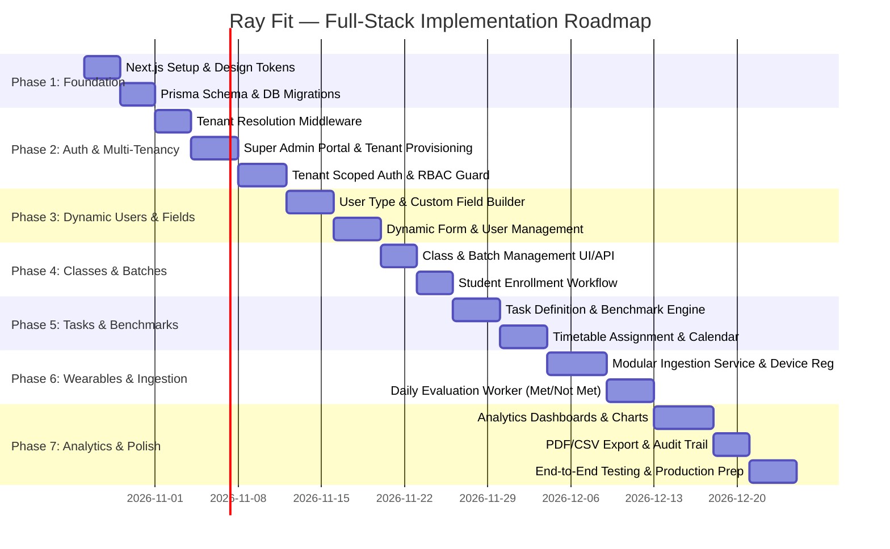

# Ray Fit — Full-Stack Project Implementation Plan
**Multi-Tenant School Health & Fitness Monitoring Platform**

---

## 1. Executive Summary & Project Overview

**Ray Fit** is an enterprise-grade, multi-tenant school health and fitness monitoring platform built to track, evaluate, and report student physical activity and physiological metrics collected via connected wearable smart bands. The platform bridges school administrators, coaches, teachers, healthcare professionals (e.g., physiotherapists), parents, and students within a unified, high-performance ecosystem.

### Core Value Propositions
- **Multi-Tenant Architecture:** Complete physical and logical isolation between schools/institutions with custom slug routing (`/[tenant-slug]/...`), custom branding, and independent data domains.
- **Granular RBAC & Dynamic Roles:** Flexible, module-and-action-based permission engine (View, Create, Edit, Delete, Assign, Export, Manage) decoupled from hardcoded roles.
- **Extensible User Type & Dynamic Form Builder:** Dynamic schema engine supporting custom fields (Text, Number, Date, Dropdown, Multi-select, Checkbox, etc.) without requiring database migrations for field updates.
- **Hierarchical Cohorts:** Classes divided into granular Batches with automated enrollment conflict resolution and coach/teacher assignments.
- **Wearable Ingestion & Benchmark Evaluation Engine:** Vendor-agnostic ingestion pipeline processing metrics (Steps, Heart Rate, Blood Pressure, Sleep Duration, SpO2) and running automated evaluation against single-value, threshold, and range benchmarks with explicit states: **Met**, **Not Met**, and **No Data**.
- **Historical Timetables & Immutable Audits:** Version-controlled task assignments preserving historical evaluation criteria for retrospective reporting integrity.
- **Modern, Accessible UI/UX:** Built with Next.js App Router, TypeScript, Tailwind CSS, shadcn/ui, TanStack Query, and Lucide React, supporting responsive layouts, dark/light themes, and glassmorphic data dashboards.

---

## 2. Technical Stack & Architecture

### 2.1 Technology Stack Matrix

| Layer | Technology | Justification & Purpose |
| :--- | :--- | :--- |
| **Framework** | Next.js 14+ (App Router) | Server-Side Rendering (SSR), Server Components (RSC), Edge-ready Middleware for tenant resolution, and API Route Handlers. |
| **Language** | TypeScript (Strict Mode) | Full-stack end-to-end type safety, strict null checks, and shared DTOs between client and server. |
| **Styling & Design** | Tailwind CSS + CSS Variables | Curated design tokens, glassmorphism, responsive utilities, seamless dark/light mode switching. |
| **Component System**| shadcn/ui + Radix UI Primitives | Accessible (WAI-ARIA compliant), unstyled primitives styled with custom tokens, full ownership of code. |
| **State & Server Cache** | TanStack Query v5 (`@tanstack/react-query`) | Optimistic mutations, declarative data fetching, automated query invalidation, caching, and retry logic. |
| **Database & ORM** | PostgreSQL + Prisma ORM | Relational integrity, foreign key constraints, connection pooling, automated migrations, and JSONB indexing for custom fields. |
| **Authentication** | NextAuth.js / Auth.js (or custom JWT with Iron Session) | Tenant-scoped session cookies, secure bcrypt/argon2 hashing, CSRF protection, and multi-tenant login resolution. |
| **Validation** | Zod | Runtime schema validation for API inputs, environment variables, dynamic custom field validation, and form controls (React Hook Form). |
| **Icons & Media** | Lucide React | Consistent, scalable vector icons across all modules and dashboards. |
| **Charts & Visuals** | Recharts / Chart.js | Interactive trend charts, heart-rate zones, step distributions, and benchmark completion gauges. |
| **Export Engines** | PDFKit / Puppeteer & `csv-stringify` | Server-side generation of batch, class, and student health compliance reports in PDF and CSV formats. |

### 2.2 System Architecture Diagram

```mermaid
graph TD
    Client[Web Browser / Tablet / Mobile] -->|HTTPS Request| Cloudflare[Edge Network / Reverse Proxy]
    Cloudflare -->|Path: /[tenant-slug]/* | Middleware[Next.js Edge Middleware]
    
    subgraph "Next.js Application (App Router)"
        Middleware -->|Validate Slug & Inject Tenant Context| AppRouter[Next.js App Router]
        AppRouter -->|Page Render| ServerComponents[React Server Components]
        AppRouter -->|API Request| RouteHandlers[API Route Handlers / Server Actions]
        
        RouteHandlers --> AuthMiddleware[Tenant & RBAC Verification Guard]
        AuthMiddleware --> ServiceLayer[Feature Business Services]
        
        subgraph "Core Business Services"
            ServiceLayer --> TenantService[Tenant & Organization Service]
            ServiceLayer --> UserService[User & Dynamic Field Service]
            ServiceLayer --> AcademicService[Class & Batch Enrollment Service]
            ServiceLayer --> BenchmarkEngine[Benchmark Evaluation Engine]
            ServiceLayer --> WearableIngestion[Modular Wearable Ingestion Service]
            ServiceLayer --> ReportingService[Aggregations & Analytics Service]
            ServiceLayer --> AuditService[Audit Logging Service]
        end
    end

    subgraph "Data Storage & Cache"
        ServiceLayer --> PrismaClient[Prisma ORM Client]
        PrismaClient --> Postgres[(PostgreSQL Primary Database)]
        WearableIngestion --> IngestionQueue[(Ingestion Queue / Cache)]
    end

    subgraph "External Wearable Ecosystem"
        WearableDevice[Smart Bands / BLE / Vendor SDK] -->|Webhook / Sync API| WearableIngestion
    end
```

---

## 3. Database Schema Design (Prisma ORM)

The relational schema strictly enforces tenant isolation with foreign key cascades, unique composite constraints `[tenantId, ...]`, and JSONB fields for dynamic custom profile data.

```prisma
datasource db {
  provider = "postgresql"
  url      = env("DATABASE_URL")
}

generator client {
  provider = "prisma-client-js"
}

// ==========================================
// 1. TENANT MANAGEMENT
// ==========================================

enum TenantStatus {
  ACTIVE
  SUSPENDED
  TRIAL
  ARCHIVED
}

model Tenant {
  id               String            @id @default(uuid())
  name             String
  slug             String            @unique // e.g. "green-valley-school"
  logoUrl          String?
  primaryColor     String?           @default("#0f766e")
  secondaryColor   String?           @default("#f59e0b")
  contactEmail     String
  contactPhone     String?
  address          String?
  status           TenantStatus      @default(ACTIVE)
  subscriptionPlan String?           @default("standard")
  createdAt        DateTime          @default(now())
  updatedAt        DateTime          @updatedAt

  users            User[]
  roles            Role[]
  userTypes        UserType[]
  classes          Class[]
  tasks            HealthTask[]
  benchmarkVersions BenchmarkVersion[]
  timetables       TimetableAssignment[]
  wearableDevices  WearableDevice[]
  healthRecords    HealthMetricRecord[]
  evaluations      TaskEvaluationResult[]
  auditLogs        AuditLog[]

  @@index([slug])
  @@index([status])
}

// ==========================================
// 2. AUTHENTICATION, ROLES & PERMISSIONS
// ==========================================

enum PlatformRole {
  SUPER_ADMIN // Platform owner
  TENANT_USER // Scoped to tenant
}

model User {
  id              String         @id @default(uuid())
  tenantId        String?        // Null for platform Super Admins
  email           String
  phone           String?
  passwordHash    String
  fullName        String
  platformRole    PlatformRole   @default(TENANT_USER)
  roleId          String?        // Tenant-specific RBAC role
  userTypeId      String?        // e.g. Student, Parent, Coach, Teacher
  isActive        Boolean        @default(true)
  profileData     Json?          // Dynamic custom field values validated against UserType schema
  lastLoginAt     DateTime?
  createdAt       DateTime       @default(now())
  updatedAt       DateTime       @updatedAt

  tenant          Tenant?        @relation(fields: [tenantId], references: [id], onDelete: Cascade)
  role            Role?          @relation(fields: [roleId], references: [id], onDelete: Restrict)
  userType        UserType?      @relation(fields: [userTypeId], references: [id], onDelete: Restrict)

  // Academic Relations
  enrollments     StudentEnrollment[]
  instructedBatches BatchInstructor[]
  
  // Health & Wearables
  assignedDevices WearableDevice[]
  healthRecords   HealthMetricRecord[]
  evaluations     TaskEvaluationResult[]
  createdTasks    HealthTask[]   @relation("CreatedTasks")
  auditActions    AuditLog[]

  @@unique([tenantId, email])
  @@index([tenantId, userTypeId])
  @@index([tenantId, roleId])
  @@index([email])
}

model Role {
  id          String           @id @default(uuid())
  tenantId    String
  name        String           // e.g. "School Admin", "Head Coach", "Physiotherapist"
  description String?
  isSystem    Boolean          @default(false)
  createdAt   DateTime         @default(now())
  updatedAt   DateTime         @updatedAt

  tenant      Tenant           @relation(fields: [tenantId], references: [id], onDelete: Cascade)
  users       User[]
  permissions RolePermission[]

  @@unique([tenantId, name])
  @@index([tenantId])
}

model Permission {
  id          String           @id @default(uuid())
  module      String           // e.g. "USERS", "CLASSES", "TASKS", "BENCHMARKS", "REPORTS", "AUDIT"
  action      String           // e.g. "VIEW", "CREATE", "EDIT", "DELETE", "ASSIGN", "EXPORT", "MANAGE"
  description String?

  roles       RolePermission[]

  @@unique([module, action])
}

model RolePermission {
  roleId       String
  permissionId String

  role         Role       @relation(fields: [roleId], references: [id], onDelete: Cascade)
  permission   Permission @relation(fields: [permissionId], references: [id], onDelete: Cascade)

  @@id([roleId, permissionId])
}

// ==========================================
// 3. DYNAMIC USER TYPES & CUSTOM FIELDS
// ==========================================

enum FieldType {
  TEXT
  NUMBER
  DATE
  EMAIL
  PHONE
  DROPDOWN
  MULTI_SELECT
  CHECKBOX
  TEXTAREA
}

model UserType {
  id           String        @id @default(uuid())
  tenantId     String
  name         String        // e.g. "Student", "Parent", "Coach", "Physiotherapist"
  slug         String        // e.g. "student", "parent"
  iconName     String?       @default("User")
  isSystem     Boolean       @default(false)
  createdAt    DateTime      @default(now())
  updatedAt    DateTime      @updatedAt

  tenant       Tenant        @relation(fields: [tenantId], references: [id], onDelete: Cascade)
  customFields CustomField[]
  users        User[]

  @@unique([tenantId, slug])
  @@index([tenantId])
}

model CustomField {
  id           String     @id @default(uuid())
  userTypeId   String
  label        String     // e.g. "Emergency Contact Name"
  fieldKey     String     // e.g. "emergency_contact_name"
  fieldType    FieldType
  isRequired   Boolean    @default(false)
  placeholder  String?
  options      Json?      // Array of options for DROPDOWN / MULTI_SELECT: ["A+", "B+", "O+"]
  validation   Json?      // Regex patterns, min/max limits, etc.
  displayOrder Int        @default(0)
  createdAt    DateTime   @default(now())
  updatedAt    DateTime   @updatedAt

  userType     UserType   @relation(fields: [userTypeId], references: [id], onDelete: Cascade)

  @@unique([userTypeId, fieldKey])
  @@index([userTypeId, displayOrder])
}

// ==========================================
// 4. ACADEMIC STRUCTURE: CLASSES & BATCHES
// ==========================================

model Class {
  id             String     @id @default(uuid())
  tenantId       String
  name           String     // e.g. "Grade 10"
  academicPeriod String     // e.g. "2026-2027"
  description    String?
  isActive       Boolean    @default(true)
  createdAt      DateTime   @default(now())
  updatedAt      DateTime   @updatedAt

  tenant         Tenant     @relation(fields: [tenantId], references: [id], onDelete: Cascade)
  batches        Batch[]
  tasks          HealthTaskAssignment[]

  @@unique([tenantId, name, academicPeriod])
  @@index([tenantId])
}

model Batch {
  id          String             @id @default(uuid())
  classId     String
  name        String             // e.g. "Batch A", "Morning Athletics"
  capacity    Int                @default(30)
  schedule    String?            // e.g. "Mon, Wed, Fri 08:00 - 09:30"
  isActive    Boolean            @default(true)
  createdAt   DateTime           @default(now())
  updatedAt   DateTime           @updatedAt

  class       Class              @relation(fields: [classId], references: [id], onDelete: Cascade)
  instructors BatchInstructor[]
  enrollments StudentEnrollment[]
  tasks       HealthTaskAssignment[]

  @@unique([classId, name])
  @@index([classId])
}

model BatchInstructor {
  batchId   String
  userId    String // Coach / Teacher
  role      String? @default("Primary Coach")

  batch     Batch  @relation(fields: [batchId], references: [id], onDelete: Cascade)
  user      User   @relation(fields: [userId], references: [id], onDelete: Cascade)

  @@id([batchId, userId])
}

model StudentEnrollment {
  id          String   @id @default(uuid())
  batchId     String
  studentId   String
  rollNumber  String?
  enrolledAt  DateTime @default(now())
  isActive    Boolean  @default(true)

  batch       Batch    @relation(fields: [batchId], references: [id], onDelete: Cascade)
  student     User     @relation(fields: [studentId], references: [id], onDelete: Cascade)

  @@unique([batchId, studentId])
  @@index([batchId])
  @@index([studentId])
}

// ==========================================
// 5. HEALTH TASKS, BENCHMARKS & TIMETABLES
// ==========================================

enum HealthMetricType {
  STEPS
  HEART_RATE
  BLOOD_PRESSURE_SYSTOLIC
  BLOOD_PRESSURE_DIASTOLIC
  SLEEP_DURATION_MINUTES
  CALORIES_BURNED
  ACTIVE_MINUTES
  SPO2_PERCENTAGE
}

enum BenchmarkOperator {
  GREATER_THAN_OR_EQUAL
  LESS_THAN_OR_EQUAL
  EXACT_MATCH
  BETWEEN_INCLUSIVE
  BETWEEN_EXCLUSIVE
}

enum FrequencyType {
  DAILY
  WEEKLY
  SPECIFIC_TIME_WINDOW
}

model HealthTask {
  id          String                 @id @default(uuid())
  tenantId    String
  createdById String
  title       String                 // e.g. "Morning Cardio Step Goal"
  description String?
  metricType  HealthMetricType
  unit        String                 // e.g. "steps", "bpm", "mmHg", "minutes"
  frequency   FrequencyType          @default(DAILY)
  isActive    Boolean                @default(true)
  createdAt   DateTime               @default(now())
  updatedAt   DateTime               @updatedAt

  tenant      Tenant                 @relation(fields: [tenantId], references: [id], onDelete: Cascade)
  createdBy   User                   @relation("CreatedTasks", fields: [createdById], references: [id], onDelete: Restrict)
  benchmarks  BenchmarkVersion[]
  assignments HealthTaskAssignment[]

  @@index([tenantId, metricType])
}

model BenchmarkVersion {
  id               String            @id @default(uuid())
  taskId           String
  tenantId         String
  versionNumber    Int               @default(1)
  operator         BenchmarkOperator
  minValue         Decimal?          @db.Decimal(10, 2)
  maxValue         Decimal?          @db.Decimal(10, 2)
  targetValue      Decimal?          @db.Decimal(10, 2)
  clinicalNotes    String?           // Notes or guidelines from physiotherapist/physician
  effectiveFrom    DateTime          @default(now())
  effectiveTo      DateTime?         // Null means currently active version
  createdAt        DateTime          @default(now())

  task             HealthTask        @relation(fields: [taskId], references: [id], onDelete: Cascade)
  tenant           Tenant            @relation(fields: [tenantId], references: [id], onDelete: Cascade)
  timetableEntries TimetableAssignment[]
  evaluations      TaskEvaluationResult[]

  @@index([taskId, versionNumber])
  @@index([tenantId])
}

model HealthTaskAssignment {
  id          String     @id @default(uuid())
  taskId      String
  classId     String?    // If assigned at class level
  batchId     String?    // If assigned at batch level
  startDate   DateTime
  endDate     DateTime
  isActive    Boolean    @default(true)
  createdAt   DateTime   @default(now())

  task        HealthTask @relation(fields: [taskId], references: [id], onDelete: Cascade)
  class       Class?     @relation(fields: [classId], references: [id], onDelete: Cascade)
  batch       Batch?     @relation(fields: [batchId], references: [id], onDelete: Cascade)

  timetableEntries TimetableAssignment[]

  @@index([taskId])
  @@index([classId])
  @@index([batchId])
}

model TimetableAssignment {
  id                 String               @id @default(uuid())
  tenantId           String
  assignmentId       String
  benchmarkVersionId String
  scheduledDate      DateTime             @db.Date
  windowStartTime    String?              // e.g. "07:00"
  windowEndTime      String?              // e.g. "18:00"
  status             String               @default("SCHEDULED") // SCHEDULED, ACTIVE, COMPLETED, EXPIRED
  createdAt          DateTime             @default(now())

  tenant             Tenant               @relation(fields: [tenantId], references: [id], onDelete: Cascade)
  assignment         HealthTaskAssignment @relation(fields: [assignmentId], references: [id], onDelete: Cascade)
  benchmarkVersion   BenchmarkVersion     @relation(fields: [benchmarkVersionId], references: [id], onDelete: Restrict)
  evaluations        TaskEvaluationResult[]

  @@unique([assignmentId, scheduledDate])
  @@index([tenantId, scheduledDate])
}

// ==========================================
// 6. WEARABLES, HEALTH DATA & EVALUATION
// ==========================================

enum DeviceStatus {
  UNPAIRED
  ACTIVE
  SYNCING
  MAINTENANCE
  DECOMMISSIONED
}

model WearableDevice {
  id           String             @id @default(uuid())
  tenantId     String
  studentId    String?
  deviceUuid   String             // Hardware MAC address or unique vendor serial
  vendorName   String             // e.g. "Fitbit", "Garmin", "RayBand Pro", "Generic BLE"
  modelNumber  String?
  firmwareVer  String?
  batteryLevel Int?               @default(100)
  status       DeviceStatus       @default(ACTIVE)
  lastSyncAt   DateTime?
  registeredAt DateTime           @default(now())
  updatedAt    DateTime           @updatedAt

  tenant       Tenant             @relation(fields: [tenantId], references: [id], onDelete: Cascade)
  student      User?              @relation(fields: [studentId], references: [id], onDelete: SetNull)
  measurements HealthMetricRecord[]

  @@unique([tenantId, deviceUuid])
  @@index([tenantId, studentId])
}

model HealthMetricRecord {
  id          String           @id @default(uuid())
  tenantId    String
  studentId   String
  deviceId    String?
  metricType  HealthMetricType
  numericVal  Decimal          @db.Decimal(10, 2)
  unit        String
  recordedAt  DateTime         // Original timestamp on band
  syncedAt    DateTime         @default(now())
  rawPayload  Json?            // Original vendor payload for audit/debugging

  tenant      Tenant           @relation(fields: [tenantId], references: [id], onDelete: Cascade)
  student     User             @relation(fields: [studentId], references: [id], onDelete: Cascade)
  device      WearableDevice?  @relation(fields: [deviceId], references: [id], onDelete: SetNull)

  @@index([tenantId, studentId, metricType, recordedAt])
  @@index([tenantId, recordedAt])
}

enum EvaluationStatus {
  MET
  NOT_MET
  NO_DATA
}

model TaskEvaluationResult {
  id                  String               @id @default(uuid())
  tenantId            String
  studentId           String
  timetableEntryId    String
  benchmarkVersionId  String
  evaluationDate      DateTime             @db.Date
  status              EvaluationStatus
  aggregatedValue     Decimal?             @db.Decimal(10, 2) // Calculated daily total/avg
  thresholdSummary    String               // e.g. "Achieved 10,420 steps (Target: >= 8,000 steps)"
  evaluatedAt         DateTime             @default(now())

  tenant              Tenant               @relation(fields: [tenantId], references: [id], onDelete: Cascade)
  student             User                 @relation(fields: [studentId], references: [id], onDelete: Cascade)
  timetableEntry      TimetableAssignment  @relation(fields: [timetableEntryId], references: [id], onDelete: Cascade)
  benchmarkVersion    BenchmarkVersion     @relation(fields: [benchmarkVersionId], references: [id], onDelete: Restrict)

  @@unique([studentId, timetableEntryId, evaluationDate])
  @@index([tenantId, evaluationDate, status])
  @@index([studentId, evaluationDate])
}

// ==========================================
// 7. SYSTEM AUDITABILITY & LOGS
// ==========================================

model AuditLog {
  id          String   @id @default(uuid())
  tenantId    String?  // Null for platform Super Admin global actions
  userId      String?
  action      String   // e.g. "TENANT_CREATED", "USER_ROLE_UPDATED", "BENCHMARK_MODIFIED"
  module      String   // e.g. "TENANTS", "AUTH", "TASKS", "BENCHMARKS"
  details     Json?    // Detailed diff: { previous: {...}, next: {...} }
  ipAddress   String?
  userAgent   String?
  createdAt   DateTime @default(now())

  tenant      Tenant?  @relation(fields: [tenantId], references: [id], onDelete: Cascade)
  user        User?    @relation(fields: [userId], references: [id], onDelete: SetNull)

  @@index([tenantId, createdAt])
  @@index([module, action])
}
```

---

## 4. Multi-Tenant Architecture & Request Lifecycle

### 4.1 URL Routing Strategy
To achieve high-trust branding and strict tenant identification without exposing internal IDs:
- **Platform Super Admin:** Accesses `/admin` or dedicated subdomain `admin.rayfit.io`.
- **Tenant Specific Routing:** Root path uses the tenant's validated unique slug:
  - Login: `/[tenant-slug]/login`
  - Dashboard: `/[tenant-slug]/dashboard`
  - User Types: `/[tenant-slug]/users/[userTypeSlug]`
  - Classes & Batches: `/[tenant-slug]/classes`
  - Health Tasks & Timetables: `/[tenant-slug]/tasks`
  - Wearables & Ingestion: `/[tenant-slug]/wearables`
  - Reports & Analytics: `/[tenant-slug]/reports`
  - Settings & Roles: `/[tenant-slug]/settings`

### 4.2 Tenant Context Resolution Middleware


### 4.3 Tenant Isolation Guarantee
Every database query in business services and repositories includes an explicit `where: { tenantId }` clause. Multi-tenant helpers wrap Prisma queries into tenant-scoped context factories:
```typescript
// Example: lib/prisma-tenant.ts
export function createTenantPrisma(tenantId: string) {
  return prisma.$extends({
    query: {
      $allModels: {
        async $allOperations({ model, operation, args, query }) {
          if ('tenantId' in (prisma[model as any]?.fields || {})) {
            if (operation === 'create') {
              (args as any).data = { ...(args as any).data, tenantId };
            } else if (['findUnique', 'findFirst', 'findMany', 'update', 'delete'].includes(operation)) {
              (args as any).where = { ...(args as any).where, tenantId };
            }
          }
          return query(args);
        },
      },
    },
  });
}
```

---

## 5. Granular RBAC & Permission Matrix

Permissions are structured as `Module:Action` combinations. Hardcoded role checks are replaced with capability checks (`hasPermission(user, 'TASKS:ASSIGN')`).

### 5.1 System Modules & Action Matrix

| Module | Available Actions | Description |
| :--- | :--- | :--- |
| `TENANTS` | `VIEW`, `CREATE`, `EDIT`, `DELETE`, `MANAGE` | Platform Super Admin tenant lifecycle management. |
| `ROLES` | `VIEW`, `CREATE`, `EDIT`, `DELETE`, `ASSIGN` | Organization custom roles and permission assignment. |
| `USER_TYPES` | `VIEW`, `CREATE`, `EDIT`, `DELETE`, `MANAGE_FIELDS` | Dynamic user type and custom field builder. |
| `USERS` | `VIEW`, `CREATE`, `EDIT`, `DELETE`, `EXPORT`, `RESET_PWD` | User profile, enrollment, and credential management. |
| `CLASSES` | `VIEW`, `CREATE`, `EDIT`, `DELETE`, `ASSIGN_STAFF` | Academic classes, academic years, and descriptions. |
| `BATCHES` | `VIEW`, `CREATE`, `EDIT`, `DELETE`, `ENROLL_STUDENTS` | Batches within classes, capacities, and scheduling. |
| `TASKS` | `VIEW`, `CREATE`, `EDIT`, `DELETE`, `ASSIGN` | Metric task definitions and assignments. |
| `BENCHMARKS` | `VIEW`, `CREATE`, `EDIT`, `DEACTIVATE` | Configurable evaluation thresholds and operator rules. |
| `TIMETABLES` | `VIEW`, `CREATE`, `EDIT`, `DELETE` | Class/batch monitoring schedules and task calendar. |
| `WEARABLES` | `VIEW`, `REGISTER`, `PAIR`, `UNPAIR`, `INGEST` | Device fleet management and sync logs. |
| `REPORTS` | `VIEW_STUDENT`, `VIEW_BATCH`, `VIEW_CLASS`, `EXPORT` | Analytics, completion metrics, and PDF/CSV downloads. |
| `AUDIT` | `VIEW`, `EXPORT` | Full organization audit trail. |

### 5.2 Server-Side Permission Guard
```typescript
// server/guards/rbac.ts
export async function requirePermission(
  session: SessionUser,
  module: string,
  action: string
) {
  if (session.platformRole === 'SUPER_ADMIN') return true;

  const hasPerm = await prisma.rolePermission.findFirst({
    where: {
      roleId: session.roleId,
      permission: { module, action },
    },
  });

  if (!hasPerm) {
    throw new ForbiddenError(`Missing permission: ${module}:${action}`);
  }
  return true;
}
```

---

## 6. Dynamic User Type & Custom Field Builder Engine

### 6.1 Architectural Decoupling: Identity vs. Profile
1. **Identity & Authentication (Fixed Relational Columns):**
   - `id`, `tenantId`, `email`, `phone`, `passwordHash`, `fullName`, `isActive`
   - Encrypted/hashed credentials, rate limiting, and password reset workflows.
2. **Dynamic Profile Attributes (`profileData` JSONB):**
   - Stored in a JSONB column on the `User` table.
   - Structured according to the `CustomField` specifications linked to the user's `UserType`.
   - Indexed via GIN index (`CREATE INDEX idx_user_profile ON "User" USING gin (profileData);`) for high-speed attribute queries.

### 6.2 Supported Field Types & Dynamic Form Generation
The frontend renders dynamic forms using React Hook Form and dynamically generated Zod schemas based on the active `CustomField` models:

```typescript
// lib/validators/dynamic-field-schema.ts
import { z } from 'zod';

export function buildDynamicUserSchema(fields: CustomField[]) {
  const shape: Record<string, z.ZodTypeAny> = {
    fullName: z.string().min(2, "Full Name is required"),
    email: z.string().email("Invalid email address"),
    phone: z.string().optional(),
    password: z.string().min(8, "Password must be at least 8 characters").optional(),
  };

  fields.forEach(field => {
    let validator: z.ZodTypeAny;

    switch (field.fieldType) {
      case 'TEXT':
      case 'TEXTAREA':
        validator = z.string();
        break;
      case 'NUMBER':
        validator = z.coerce.number();
        break;
      case 'DATE':
        validator = z.coerce.date();
        break;
      case 'EMAIL':
        validator = z.string().email();
        break;
      case 'CHECKBOX':
        validator = z.boolean();
        break;
      case 'DROPDOWN':
        const opts = (field.options as string[]) || [];
        validator = z.enum(opts as [string, ...string[]]);
        break;
      case 'MULTI_SELECT':
        validator = z.array(z.string());
        break;
      default:
        validator = z.any();
    }

    if (!field.isRequired) {
      validator = validator.optional().nullable();
    }

    shape[field.fieldKey] = validator;
  });

  return z.object(shape);
}
```

---

## 7. Wearable Band Integration & Evaluation Engine

### 7.1 Vendor-Agnostic Modular Ingestion Architecture
To prevent lock-in to a specific band vendor, the ingestion system defines a standard interface:

```typescript
// services/wearables/types.ts
export interface NormalizedWearablePayload {
  deviceUuid: string;
  vendorName: string;
  timestamp: Date;
  metrics: {
    metricType: HealthMetricType;
    numericVal: number;
    unit: string;
    raw?: Record<string, any>;
  }[];
}

export interface IWearableConnector {
  vendorName: string;
  validateWebhookSignature(headers: Headers, body: string): boolean;
  normalizePayload(rawBody: any): Promise<NormalizedWearablePayload[]>;
}
```

### 7.2 Benchmark Evaluation Engine
The benchmark engine runs daily (or upon data synchronization) to evaluate recorded health metrics against active timetable assignments.

#### Benchmark Operators & Rules
1. `GREATER_THAN_OR_EQUAL`: Target metric $\ge$ `minValue`. (e.g., Steps $\ge 8,000$).
2. `LESS_THAN_OR_EQUAL`: Target metric $\le$ `maxValue`. (e.g., Resting Heart Rate $\le 75\text{ bpm}$).
3. `BETWEEN_INCLUSIVE`: `minValue` $\le$ Target metric $\le$ `maxValue`. (e.g., Systolic Blood Pressure between $90$ and $120\text{ mmHg}$).
4. `BETWEEN_EXCLUSIVE`: `minValue` $<$ Target metric $<$ `maxValue`.
5. `EXACT_MATCH`: Target metric $=$ `targetValue`.

#### Deterministic Status Resolution
- **`NO_DATA`:** The student has an active assignment for the date, but no wearable records were received for the specified metric. *(Missing data is never penalized as a failure/Not Met)*.
- **`MET`:** The student's recorded metric satisfies the assigned benchmark condition.
- **`NOT_MET`:** Wearable data exists for the measurement window, but the value failed the benchmark condition.



---

## 8. Class & Batch Timetables with Historical Versioning

1. **Immutable Historical Rules:** When a coach or teacher updates a benchmark (e.g., raising daily steps from $6,000$ to $8,000$), the system does not overwrite the old benchmark. Instead:
   - A new `BenchmarkVersion` is created with an incremented `versionNumber` and an updated `effectiveFrom` timestamp.
   - The prior version's `effectiveTo` is closed.
   - Historical timetable assignments retain their original `benchmarkVersionId`, ensuring past compliance reports remain 100% accurate.
2. **Timetable Calendar View:**
   - Visual monthly/weekly calendar indicating scheduled tasks for classes and batches.
   - Status indicators: Upcoming, Active, Completed, Expired.
   - Direct link to real-time student evaluation progress.

---

## 9. Comprehensive Reporting & Analytics System

### 9.1 Multi-Dimensional Report Matrix



### 9.2 Analytics Dashboard Visualizations
- **Compliance Donut Charts:** Ratio of Met vs. Not Met vs. No Data.
- **Time-Series Metric Line Charts:** Multi-line overlays showing individual or average student readings against threshold benchmarks.
- **Batch Leaderboard & Heatmaps:** Visual representations of active engagement without public student shaming (anonymized or coach-only visibility).
- **Export Formats:**
  - **CSV:** Raw measurement data and evaluated results for external statistical analysis.
  - **PDF:** Formal printable school health certificates and term reports with institutional branding.

---

## 10. UI/UX Design System & Theme Tokens

### 10.1 Curated Visual Language
- **Typography:** Inter or Outfit from Google Fonts with crisp rendering and legible weights.
- **Color Palette (Modern Slate & Emerald/Cyan):**
  - Background: Light `#f8fafc` / Dark `#090d16`
  - Cards & Glass: Light `rgba(255, 255, 255, 0.85)` / Dark `rgba(17, 24, 39, 0.75)` with `backdrop-blur-md`
  - Accent / Primary: Deep Teal `#0f766e` to Emerald `#10b981`
  - Warning / Benchmark Not Met: Amber `#f59e0b` / Coral Rose `#f43f5e`
  - Success / Benchmark Met: Crisp Emerald `#10b981`
  - Neutral / No Data: Muted Slate `#64748b`
- **Dynamic Elements:**
  - Skeleton loaders for tables, metric cards, and charts.
  - Meaningful empty states with contextual call-to-actions ("No health tasks assigned yet").
  - Accessible dialogs, drawers, dropdowns, and toast notifications.

---

## 11. Security, Compliance & Audit Trail

1. **Password Security:** Salted hashing with `argon2id` or `bcrypt` (work factor 12).
2. **Tenant Boundary Defense:**
   - Middleware-level slug validation.
   - Session-level tenant verification.
   - ORM-level tenant ID injection.
3. **Audit Logging Engine:**
   - Every administrative mutation (creating a user, altering role permissions, changing benchmark thresholds, assigning tasks, manual data overrides) emits an `AuditLog` entry capturing the actor, tenant, timestamp, IP address, and payload diff.
4. **Data Privacy (HIPAA/FERPA-aligned Best Practices):**
   - Health metrics separated from direct government identifiers.
   - Role-scoped data isolation (e.g., teachers see physical activity; physiotherapists see clinical notes and cardiovascular readings; parents see only linked children).

---

## 12. Phased Implementation Roadmap



### Phase Details

#### Phase 1: Architecture, Tooling & Database Foundation
- Initialize Next.js project with TypeScript strict mode, Tailwind CSS, shadcn/ui, and TanStack Query.
- Configure PostgreSQL database, connection pooling, and Prisma ORM.
- Deploy complete multi-tenant schema with all models, enums, indices, and seed data generator.
- Implement design tokens, typography, glassmorphism styles, and base layout shells.

#### Phase 2: Multi-Tenancy, Super Admin & RBAC
- Build Edge Middleware for tenant resolution via URL slug (`/[tenant-slug]/...`).
- Implement platform Super Admin portal for tenant creation, suspension, and plan configuration.
- Provision transactional onboarding for new schools (create tenant + default admin + standard roles).
- Implement granular RBAC middleware and UI capability directives.

#### Phase 3: Dynamic User Types & Custom Field Builder
- Build administrative UI to create and configure User Types (Students, Coaches, Teachers, Parents, Physiotherapists).
- Implement custom field builder (Text, Number, Date, Dropdown, Multi-Select, Checkbox, etc.).
- Build dynamic schema generator (Zod) and form rendering components.
- Develop user management views with pagination, status filters, bulk actions, and export.

#### Phase 4: Academic Hierarchy: Classes, Batches & Enrollments
- Implement Class and Batch management modules.
- Assign instructors and coaches to batches.
- Implement student enrollment workflow with duplicate detection and capacity validation.
- Build class/batch summary cards, student rosters, and scheduling overviews.

#### Phase 5: Health Tasks, Benchmarks & Timetables
- Implement Health Task catalog with configurable metric types and units.
- Build the Benchmark Engine supporting single values, thresholds, ranges, and clinical notes.
- Implement immutable versioning for benchmarks upon modification.
- Build interactive Class and Batch Timetable calendars.

#### Phase 6: Wearable Band Ingestion & Automated Evaluation
- Construct vendor-agnostic ingestion layer with device registration and account pairing.
- Build telemetry ingestion endpoints with signature validation and duplicate detection.
- Implement automated benchmark evaluation worker computing **Met**, **Not Met**, and **No Data**.
- Add manual telemetry entry and recalculation features for authorized staff.

#### Phase 7: Reporting, Analytics, Security & Production Hardening
- Build multi-tier analytics dashboards (Student, Batch, Class, Task) with interactive charts.
- Implement CSV and PDF export engines for school health records.
- Implement system-wide Audit Logging for all administrative actions.
- Conduct security audits, tenant boundary isolation tests, responsive UI verification, and documentation.

---

## 13. Verification, Testing & Quality Assurance Plan

1. **Tenant Isolation Unit & Integration Tests:**
   - Test that queries originating with Tenant A context never return Tenant B records.
   - Verify that attempts to access `/[tenant-b-slug]/...` with a Tenant A session yield an immediate 403 Forbidden redirect.
2. **Benchmark Engine Unit Tests:**
   - Comprehensive test cases covering all operators (`GREATER_THAN_OR_EQUAL`, `BETWEEN_INCLUSIVE`, etc.).
   - Explicit tests confirming missing wearable data produces `NO_DATA` rather than `NOT_MET`.
   - Tests ensuring historical timetable assignments preserve previous benchmark versions.
3. **Dynamic Field Builder Validation Tests:**
   - Verify required vs. optional custom fields.
   - Verify dropdown enum constraints and type coercion (strings to numbers/dates).
4. **End-to-End Browser Tests:**
   - Flow 1: Super Admin creates Tenant -> Logs into Tenant as School Admin.
   - Flow 2: School Admin creates custom field for Student -> Registers Student -> Verifies field in profile.
   - Flow 3: Coach assigns Steps Task to Batch -> Wearable data ingested -> Evaluation marks result as `MET`.
   - Flow 4: Student/Parent views personal health timetable and progress report.

---

*This document serves as the authoritative, engineering-grade implementation plan for Ray Fit.*
